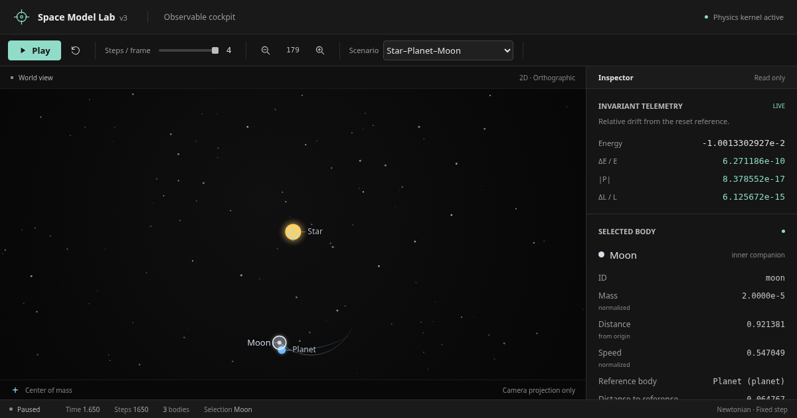

# Space Model Lab v3

Space Model Lab v3 is both:

* an educational browser-based 2D Newtonian N-body sandbox
* a controlled multi-agent LLM development case study with reproducible baseline verification

The cockpit offers two fixed educational scenarios: the six-body N-body baseline (default) and a mutually gravitating Star–Planet–Moon hierarchy. Both use the same softened Newtonian force and fixed-step Velocity Verlet integrator, with live invariant telemetry and a barycenter marker.

## Why This Is Reviewable

The project is small on purpose.

The value is not only the canvas demo. The repository is structured so reviewers can inspect the physics boundary, run a headless invariant baseline, and read the decision trail behind accepted changes.

Changes are governed through decision logs, human-in-the-loop approval, single-writer git discipline, commit packets, approval gates, and receipts with observed validation results.

The public review path is based on the live cockpit, observed baseline verification, and decision records, not trust in screenshots or claims.

## Live Public Cockpit

GitHub Pages public preview:

```text
https://sergey-morev.github.io/space-model-lab-v3/
```

The scenario selector switches between the baseline and Star–Planet–Moon. Select Planet or Moon to inspect distance and speed relative to its named reference body, alongside world position and velocity. Reset restores the current scenario and preserves the selected speed.



Actual Chromium capture at 1200×630, DPR 1, with Moon selected and the hierarchy paused at fixed step 1650 (1.650 normalized time). The screenshot is presentation evidence; the headless checks below verify the dynamics. More selected-body fields are available by scrolling the inspector. The hierarchy is validated over 50 normalized time units, not claimed permanently stable or calibrated to real astronomical bodies.

GitHub Pages is the public presentation path. It does not replace local baseline validation.

## Run Locally

Node.js is required.

There are no dependencies, devDependencies, build step, or bundler.

Cross-platform local server:

```sh
node tools/serve-local.js
```

Windows launcher:

```bat
start-space-model-lab.bat
```

Alternative npm script:

```sh
npm run preview
```

Then open:

```text
http://127.0.0.1:4173/
```

Direct `file://` launch of `index.html` is not the canonical path for this ES-module app.

## Verify The Baseline

```sh
node src/dev/baseline.js
node src/dev/observable-check.js
node src/dev/hierarchy-check.js
```

Accepted baseline metrics:

```text
final status: PASS
relative energy drift: 4.290851857533e-11
momentum drift: 7.808913380318e-20
relative angular momentum drift: 3.213114654476e-15
```

This baseline checks invariant behavior for the normalized educational N-body system. It is the main public proof that the project is not only a visual canvas demo.

The model uses normalized educational Newtonian N-body units. It is not real ephemeris data, NASA data, date-accurate astronomy, or real solar-system scale.

## How This Project Is Built

This repository was built through a gated multi-agent LLM workflow.

Roles are separated: architecture/review, PM/audit, and execution. The human PI approves commits explicitly. Before a commit, the execution agent reports a COMMIT PACKET with scope, changed files, validation, risk, diff stat, and proposed message. Accepted work returns a receipt with commit hash and validation results.

This discipline is observed in the repository through source documents, decision logs, commit history, and baseline output.

## For Reviewers

Suggested route:

1. Open the live public cockpit.
2. Run the app locally if you want to inspect the no-dependency launch path.
3. Run all three verification commands above.
4. Inspect the governance and architecture docs.

Read first:

* [00_READ_FIRST.md](00_READ_FIRST.md)
* [PROJECT_SOURCE.md](PROJECT_SOURCE.md)
* [MANIFEST.md](MANIFEST.md)
* [docs/DECISION_LOG.md](docs/DECISION_LOG.md)
* [docs/ARCHITECTURE.md](docs/ARCHITECTURE.md)
* [docs/ACCEPTANCE_CRITERIA.md](docs/ACCEPTANCE_CRITERIA.md)
* [docs/PHYSICS_CONTRACT.md](docs/PHYSICS_CONTRACT.md)

Reviewer questions:

* Can you reproduce the baseline metrics?
* Are physics, simulation, render, and UI boundaries clear?
* Is the governance useful, or is it becoming process theater?
* Is this README sufficient to understand the project in 60 seconds?
* Do selection, reference values and invariants stay consistent across reset, scenario switches and camera zoom?

## GitHub Pages Status

The T9A/T11A static readiness audits found the project structurally compatible with GitHub Pages because paths are relative and JavaScript imports are case-clean.

GitHub Pages is configured from branch `main`, folder `/ root`, and is accepted as the public preview path.

The README and Open Graph / large-image card metadata share `assets/cockpit-preview.png`, a real 1200×630 browser capture. It adds no build step, tracking script or external asset dependency. Social platforms may cache previews after deployment.
